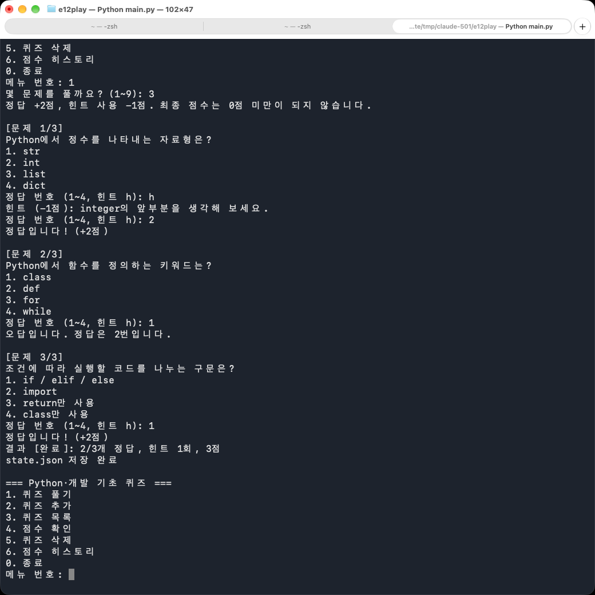

# E1-2 · Python·개발 기초 퀴즈

> Codyssey 입학 연수: 컴퓨터에게 명령 내리는 말(파이썬) 처음 배우기
> 현재: **필수 기능·보너스 5개 구현 및 검증 완료, 코드 GitHub 업로드 완료. clone/pull 실습 완료.**
> 평가자는 [0. 평가 항목별 해결 정리](#evaluation)부터 보면 항목 1~5의 해결 방법과 증거를 바로 확인할 수 있다.
> 코드와 설명은 AI 도움으로 작성·검증했다. 테스트 통과가 학습자가 내용을 스스로 설명했다는 뜻은 아니므로, 아래 과제 목표를 직접 확인한다.

## 목차

- [평가 항목별 해결 정리](#evaluation)
- [프로젝트 개요와 주제](#overview)
- [실행과 메뉴](#run)
- [구현 기능과 점수 규칙](#features)
- [파일 구조와 객체의 책임](#structure)
- [데이터 파일과 복구 정책](#data)
- [과제 목표를 설명하기](#learning)
- [실제 검증과 스크린샷](#verification)
- [Git 기록과 실습](#git-workflow)
- [미션 조건 및 제출 현황](#submission)

<a id="evaluation"></a>
## 0. 평가 항목별 해결 정리 (평가자용 요약)

평가 문항 1~5를 순서대로 따라가며 **무엇을 어떻게 해결했고, 어디서 확인하는지**를 한곳에 모았다. 각 행의 링크는 실제 실행 로그나 코드 위치다. 세부 개념 설명은 [6. 과제 목표를 설명하기](#learning)에 있다.

### 바로 확인하는 명령

```bash
git clone https://github.com/2dion/E1-2.git
cd E1-2
python3 --version                           # 3.10 이상
python3 -m unittest discover -s tests -v    # 90개 테스트, 프로젝트 state.json을 바꾸지 않음
python3 tools/capture_evidence.py           # 임시 복사본에서 실제 CLI 시나리오 12개 재현
python3 main.py                             # 직접 플레이
git log --oneline --graph --all             # 커밋·브랜치·병합 기록
```

### 항목 1. 기능 동작 검증

| 평가 문항 | 해결 방법 | 확인 위치 |
| --- | --- | --- |
| 메뉴 표시, 풀기·추가·목록·점수 확인 동작 | `QuizGame.run()`이 메뉴 번호마다 메서드 하나(`play`, `add_quiz`, `list_quizzes`, `show_score`)를 호출. 보너스로 삭제·히스토리 메뉴 추가 | [menu](docs/evidence/menu.txt) · [play](docs/evidence/play.txt) · [add-quiz](docs/evidence/add-quiz.txt) · [list](docs/evidence/list.txt) · [score](docs/evidence/score.txt) |
| 정답/오답 판정 | 게임은 비교하지 않고 `quiz.is_correct(selected)`로 Quiz에게 요청. 오답이면 정답 번호를 알려 줌 | [play](docs/evidence/play.txt), `tests/test_quiz.py` |
| 입력 오류 4가지: 공백, 문자, 범위 밖, 빈 입력 | `input_utils.read_int()`가 ① `strip()`으로 공백 제거 → ② 빈 값 안내 → ③ `int()` 실패(ValueError) 안내 → ④ 범위 검사 순서로 처리하고 다시 입력받음. 정답 입력(`ask_answer`)도 같은 순서 | [invalid-input](docs/evidence/invalid-input.txt) (입력 `\n`, `abc`, `9`, ` 0 `), `tests/test_input_utils.py` |
| 재실행 후 추가 퀴즈·최고 점수 유지 | 추가·점수 갱신 직후 `state.json`에 UTF-8로 저장하고, 시작할 때 `load_state()`로 복원. 복원에 성공하면 첫 화면에 "저장된 데이터를 불러왔습니다. (퀴즈 N개, 최고 점수 M점)"을 출력 | [restart](docs/evidence/restart.txt): 별도 프로세스에서 퀴즈 9개, 최고 5점 확인 |
| 기본 퀴즈 5개 이상 | `defaults.py`에 Python·개발 기초 문제 8개, 각각 선택지 4개·정답·힌트 | `defaults.py`, `state.json` |
| GitHub 업로드, 의미 있는 커밋 10개 이상 | 기능 단위 커밋 16개(이 보강 이전 기준, 빈 커밋 없음). 2026-11-16 실습 스크립트가 `main`과 `feature/quiz-play`를 모두 원격에 push했고, 실습 후 원격 `main`이 로컬과 같은 `4b00698`임을 `git ls-remote`로 확인 | [git-history](docs/evidence/git-history.txt), GitHub 커밋 목록 |
| 브랜치 생성·병합이 `git log --oneline --graph`에 보임 | `feature/quiz-play`에서 퀴즈 풀기를 구현하고 `--no-ff`로 병합해 병합 커밋 `22018aa`를 남김 | [git-history](docs/evidence/git-history.txt), [그래프 캡처](docs/screenshots/git-history.png) |
| clone과 pull 실습 흔적 | 별도 폴더에 clone → README 한 줄 추가 → commit → push → 원본 폴더에서 `git pull --ff-only` → 로컬·원격 main 해시 일치 확인을 `tools/publish_and_practice.sh`로 실제 실행 | [git-remote-practice](docs/evidence/git-remote-practice.txt), 복제본 커밋 `4b00698` |

### 항목 2. 코드 구조 및 설계

| 평가 문항 | 설계와 근거 |
| --- | --- |
| Quiz와 QuizGame의 책임 | **Quiz**(`quiz.py`)는 문제 하나: 질문·선택지·정답·힌트를 검증해 보관하고 `display()`, `is_correct()`를 맡는다. **QuizGame**(`quiz_game.py`)은 게임 전체: 퀴즈 목록·최고 점수·기록을 갖고 메뉴·진행·추가·목록·점수·저장 시점을 조율한다. 판정 규칙은 Quiz 한곳에만 있다 |
| 입력 / 게임 진행 / 저장 분리 기준 | 기준은 **"바뀌는 이유가 다르면 다른 파일"**. 입력 규칙은 `input_utils.py`(메뉴·문제 수·정답 번호에서 재사용), 게임 규칙은 `quiz_game.py`, 파일 형식·검증·원자적 저장은 `state_io.py`, 점수 규칙은 `scoring.py`, 시작·종료 조율은 `main.py` |
| state.json 읽기/쓰기 흐름 | **읽기**: `main()` → `QuizGame()` 생성 → `load_state()` → `state_io.load_state()`가 UTF-8로 열어 `json.load` → `validate_state()` 검증 → `Quiz.from_dict()`로 객체 복원. **쓰기**: 퀴즈 추가·삭제 직후, 한 판이 끝난 직후(`finish_session`), 그리고 종료 시 `main()`의 `finally`에서 `save_state()` → `to_state()`로 딕셔너리 변환 → 임시 파일에 쓰고 `os.replace()`로 교체 |
| Ctrl+C / EOF 안전 종료 | `input()`은 Ctrl+C에서 `KeyboardInterrupt`, 입력이 끝나면 `EOFError`를 낸다. 입력 함수는 이를 잡지 않고 바깥으로 보내(무한 재입력 방지), `main()`이 `except (EOFError, KeyboardInterrupt)`로 안내하고 `finally`에서 저장을 시도한다. 풀이 도중이면 `play()`가 그 판을 "중단"으로 기록한 뒤 다시 올려 보낸다. 저장 도중 Ctrl+C도 별도로 잡아 "저장 완료를 보장할 수 없음"을 알린다 |
| 커밋 단위와 메시지 규칙 | 미션 기능 순서대로 **되돌리면 그 기능 하나만 빠지는 크기**로 나눴다(메뉴 → Quiz → 기본 데이터 → 브랜치에서 풀기 → 병합 → 추가 → 목록 → 점수 → 보너스 → 저장 → 수정 → 테스트 → 문서). 메시지는 `유형: 무엇을 했는지`이고 유형은 Feat·Fix·Test·Docs·Chore·Merge |

### 항목 3. 핵심 기술 원리 적용

- **클래스를 쓴 이유:** 함수만 쓰면 퀴즈 딕셔너리와 최고 점수를 전역 변수나 매개변수로 계속 넘겨야 하고, 정답 비교 같은 규칙이 여러 함수에 복사되기 쉽다. 클래스는 데이터(속성)와 그 데이터를 다루는 동작(메서드)을 묶어, `quiz.is_correct(2)`처럼 객체에게 일을 맡긴다. 생성자에서 값을 검사하므로 잘못된 퀴즈 객체가 만들어지지 않는다. 대신 작은 프로그램에서는 코드가 조금 길어진다.
- **JSON을 쓴 이유와 특징:** 프로그램이 끝나면 메모리는 사라지므로 파일로 남겨야 한다. JSON은 사람이 읽을 수 있는 텍스트이고, 표준 라이브러리 `json`만으로 리스트·딕셔너리를 그대로 표현한다. 키는 큰따옴표 문자열이고 주석·마지막 쉼표를 허용하지 않는다. 사용자 정의 객체는 바로 저장되지 않아 `to_dict()` / `from_dict()`로 변환한다.
- **파일 입출력에 try/except가 필요한 이유:** 파일은 프로그램 밖에 있어 코드가 맞아도 실패한다. 이 프로그램은 실패 원인별로 다르게 처리한다.

  | 실패 상황 | 예외 | 처리 |
  | --- | --- | --- |
  | 첫 실행, 파일 없음 | `FileNotFoundError` | 기본 퀴즈 8개로 시작 |
  | 문법이 깨진 JSON | `json.JSONDecodeError` | 원본을 `.bak`으로 백업한 뒤 기본값으로 복구 |
  | UTF-8이 아닌 파일 | `UnicodeDecodeError` | 위와 동일 |
  | 필드 누락·잘못된 값 | `ValueError` (검증) | 위와 동일 |
  | 읽기 권한 없음 | `PermissionError`(`OSError`) | 손상으로 단정하지 않고, 원본 보호를 위해 이번 실행은 저장 안 함 |
  | 쓰기 실패·디스크 부족 | `OSError` | "저장 실패, 변경은 메모리에만 있음" 안내, 종료 때 재시도 |

- **브랜치와 병합:** `main`은 항상 실행 가능한 상태로 두고, 새 기능은 `feature/quiz-play`에서 만들었다. 실패해도 브랜치만 버리면 된다. 병합은 두 작업 흐름의 이력을 하나로 합치는 것이다. main에 새 커밋이 없으면 fast-forward로 흔적이 사라지므로 `--no-ff`로 병합 커밋을 남겨 그래프에서 보이게 했다.
- **state.json 구조를 이렇게 설계한 이유:** 최상위를 객체로 두어 `quizzes`·`best_score`·`has_played`·`history`를 이름으로 구분한다. 그래서 히스토리를 나중에 추가해도 기존 키가 흔들리지 않았다. `quizzes`는 순서 있는 여러 개라 리스트이고, 각 원소는 Quiz 속성과 같은 키라 객체 ↔ 딕셔너리가 1:1로 대응한다. `answer`는 화면 번호와 같은 1~4로 저장해 리스트 인덱스(0~3)와 헷갈리지 않게 했다. `has_played`는 "아직 안 함"과 "했지만 0점"을 구분하고, `schema_version`은 구조가 바뀔 때 예전 파일을 변환할 근거가 된다.

### 항목 4. 심층 인터뷰

**① 퀴즈가 1000개 이상이 되면?** 현재 방식의 한계는 다음과 같다.

- 퀴즈 하나를 추가해도 `save_state()`가 파일 전체를 다시 쓰고 `fsync`한다. 데이터가 클수록 저장마다 느려진다.
- 시작할 때 전부 읽어 메모리에 올리고 모든 항목을 검증한다. 시작이 느려진다.
- `history`는 판마다 계속 늘어나 퀴즈보다 먼저 커진다.
- 주제별 검색, 틀린 문제만 같은 조회를 하려면 매번 전체를 훑어야 한다.
- 파일이 하나라 한 곳이 깨지면 전체를 못 읽는다. 두 프로그램이 동시에 쓰면 나중에 쓴 쪽이 덮어쓴다.

대안은 표준 라이브러리 `sqlite3`(행 단위 추가·수정, 검색, 트랜잭션), 기록은 한 줄씩 덧붙이는 JSON Lines, 퀴즈와 기록 파일 분리다. 다만 1000개 정도는 JSON으로도 충분히 빠르므로 바로 바꿀 필요는 없다.

**② state.json이 손상되면?** 이미 구현한 대응은 다음과 같다.

1. **예방:** 같은 폴더 임시 파일에 끝까지 쓰고 `flush`·`fsync` 후 `os.replace()`로 한 번에 교체한다. 저장 도중 멈춰도 반쯤 쓰인 파일이 남지 않는다.
2. **백업 후 복구:** 파싱·인코딩·스키마 오류면 원본을 `state.json.corrupt-날짜시각.bak`으로 복사한 **다음에만** 기본값으로 실행한다. 백업에 실패하면 덮어쓰지 않도록 저장을 막는다. ([corrupt-recovery](docs/evidence/corrupt-recovery.txt))
3. **원인 구분:** 권한 오류는 손상이 아니므로 백업·초기화하지 않고 원본을 그대로 둔다.

더 할 수 있는 것: 저장할 때마다 직전 정상본을 남겨 손상 시 자동으로 되돌리기, 퀴즈 단위로 검증해 읽을 수 있는 문제만 살리기, 초기화 전에 "백업에서 복구 / 초기화 / 종료"를 사용자에게 묻기.

**③ 채점 방식이나 선택지 개수가 바뀌면 어디부터 고치나?** 이번 보강으로 규칙을 한곳에 모았다.

| 바뀌는 요구사항 | 먼저 고칠 곳 | 함께 확인할 곳 |
| --- | --- | --- |
| 점수 계산 (예: 정답 +3, 힌트 -2) | `scoring.py`의 `POINTS_PER_CORRECT`, `HINT_PENALTY`, `calculate_score()` | 안내 문구는 상수를 쓰므로 자동 반영. 단, `state_io._history_record()`가 저장된 기록의 점수를 같은 함수로 검증하므로, 예전 규칙의 기록이 손상으로 판정되지 않게 `schema_version`을 올리고 예전 기록은 예전 규칙으로 검증해야 한다. 기존 `best_score`를 유지할지 초기화할지도 정책으로 정한다 |
| 선택지 개수 (예: 4개 → 5개) | `quiz.py`의 `CHOICE_COUNT` | Quiz 검증, `is_correct`, 정답 입력 범위, 추가 시 선택지 입력 반복은 상수를 따라 자동 반영. `defaults.py`의 기본 문제와 이미 저장된 `state.json`은 선택지가 4개라 새 구조로 변환하거나 문제를 보충해야 한다 |

보강 전에는 `4`와 `* 2 - hints`가 `quiz.py`, `quiz_game.py`, `state_io.py` 여러 곳에 흩어져 있어 하나라도 빠뜨리면 동작이 어긋날 수 있었다. 지금은 `tests/test_scoring.py`가 상수와 검증 범위가 일치하는지 확인한다.

### 항목 5. 보너스 문제 해결

선택 보너스 5개를 모두 구현했다. 상세 규칙은 [3. 구현 기능과 점수 규칙](#features)에 있다.

| 보너스 | 구현 | 확인 위치 |
| --- | --- | --- |
| 랜덤 출제 | `rng.sample()`로 중복 없이 뽑고 원본 순서는 유지 | [play](docs/evidence/play.txt), 고정 시드 테스트 |
| 문제 수 선택 | 1~현재 문제 수 범위로 `read_int` | [play](docs/evidence/play.txt) |
| 힌트 | `h` 입력, 문제당 1회만 -1점, 힌트 없으면 차감 없음 | [play](docs/evidence/play.txt) |
| 퀴즈 삭제 | 번호 선택 → 확인/취소 → 저장 | [delete](docs/evidence/delete.txt) |
| 점수 히스토리 | 날짜·시각, 선택/실제 풀이 수, 정답·힌트·점수, 완료/중단 저장 | [history](docs/evidence/history.txt) |

### 가장 어려웠던 지점: 가설 → 확인 → 조치

커밋 기록과 코드 주석을 바탕으로 정리했다. 인터뷰 전에 본인 경험과 맞는지 다시 확인한다.

| 문제 | 가설 | 확인 | 조치 |
| --- | --- | --- | --- |
| 종료 직전 저장 중에 Ctrl+C를 다시 누르면 Traceback으로 끝남 | `main()`의 `finally`에서 부르는 `save_state()` 안에서 난 `KeyboardInterrupt`는 바깥 `except`가 이미 지나가서 잡히지 않는다 | `KeyboardInterrupt`는 `Exception`의 하위가 아니라 `except (OSError, ValueError)`에 걸리지 않음을 확인 | `save_state()`에서 `KeyboardInterrupt`를 따로 잡아 "저장 완료를 보장할 수 없음"을 알리고 `False`를 반환 (커밋 `4be7486`), 저장 중 중단 테스트 추가 |
| 처음 `git push`가 실패함 | 코드나 원격 주소가 아니라 HTTPS 인증 정보가 없다 | `git remote -v`의 원격 주소는 맞았고, 작업 환경에 GitHub 인증 정보가 없었음 | GitHub CLI로 로그인한 뒤 그 명령에만 gh 인증을 쓰도록 `tools/publish_and_practice.sh` 작성. 토큰은 출력하거나 파일에 쓰지 않음 |

<a id="overview"></a>
## 1. 프로젝트 개요와 주제

터미널에서 문제를 풀고, 새 문제를 등록하고, 목록·최고 점수·게임 기록을 확인하는 콘솔 프로그램이다. 종료 후 다시 실행해도 등록한 퀴즈와 기록이 남는다.

**주제는 Python·개발 기초다.** 사전 질문에서 공부한 자료형·조건문·self·JSON·UTF-8·EOF·의사 난수를 직접 문제로 풀며 복습할 수 있어 선정했다. 기본 문제는 8개이며 각 문제에 선택지 4개, 정답 번호 1~4, 힌트가 있다. AI 도움으로 작성한 문제이므로 제출 전 학습자가 내용과 정답을 직접 검토한다.

- 미션: [Codyssey 학습 맵](https://usr.codyssey.kr/daejeon/learning/learningMap?projectNo=154005)
- 미션용 원격 저장소: https://github.com/2dion/E1-2
- 개념 학습: [미션 사전 질문과 답변](미션%20사전%20질문과%20답변.md)
- 세부 대응: [요구사항·검증 대응표](docs/requirements.md)

<a id="run"></a>
## 2. 실행과 메뉴

Python **3.10 이상**과 Git을 사용한다. 프로그램·테스트·증거 도구 모두 **표준 라이브러리만** 사용하므로 pip 설치나 requirements.txt가 필요 없다. GitHub CLI는 업로드용 개발 도구이며 게임 실행에는 필요 없다.

```bash
cd /Users/leedongin/Documents/Codyssey/AllInOne/temp/E1-2
python3 --version
python3 main.py
```

Windows에서는 설치 환경에 따라 `py -3 main.py`를 사용할 수 있다. 어떤 폴더에서 실행하더라도 데이터는 `main.py`와 같은 프로젝트 루트에 저장된다.

```text
1. 퀴즈 풀기
2. 퀴즈 추가
3. 퀴즈 목록
4. 점수 확인
5. 퀴즈 삭제
6. 점수 히스토리
0. 종료
```

- 풀이 시작 때 문제 수를 고르면, 중복 없이 무작위로 출제한다.
- 답은 1~4, 힌트는 `h` 또는 `H`로 입력한다.
- 추가: 문제 → 선택지 4개 → 정답 번호 → 힌트(없으면 Enter).
- 삭제: 문제 번호 → 삭제 확인 1 / 취소 0. 번호 선택에서 0도 취소다.
- 메뉴·문제 수·정답 번호는 공백·빈 입력·문자·허용 범위 초과를 검사한다.
- Ctrl+C 또는 EOF에서는 안내 후 가능한 현재 상태를 저장하고 종료한다. 파일 저장에 실패하면 실패했다고 표시한다.

<a id="features"></a>
## 3. 구현 기능과 점수 규칙

### 필수 기능

- 메뉴 선택과 정상 종료, 잘못된 입력 재입력.
- 문제 출력, 답 입력, 정답·오답 안내, 마지막 결과.
- 퀴즈 추가와 파일 저장, 목록, 빈 퀴즈 처리.
- 최고 점수 비교·갱신·저장, 미플레이와 0점 구분.
- UTF-8 JSON 저장·불러오기, 재시작 후 퀴즈와 점수 유지.
- 누락·손상·읽기/쓰기 오류 및 입력 중단 처리.

### 보너스 5개

1. **랜덤 출제:** `random.Random().sample()`로 원본 목록을 건드리지 않고 중복 없이 뽑는다.
2. **문제 수 선택:** 1~현재 문제 수 중 선택한다.
3. **힌트:** `Quiz.hint`를 `h`로 확인한다. 같은 문제에서 반복 요청해도 한 번만 차감한다. 힌트가 없으면 차감하지 않는다.
4. **삭제:** 번호와 확인을 받아 삭제하고 파일에 반영한다. 모두 삭제해도 정상 실행된다.
5. **히스토리:** 시작한 판의 완료·중단 여부, 날짜·시간, 선택한 수와 실제 푼 수, 정답 수·힌트 수·점수를 저장한다. 문제 수를 고르기 전에 입력을 취소했다면 아직 시작한 판이 아니므로 기록하지 않는다.

### 점수와 기록 정책

- 정답 1개 **+2점**, 힌트를 사용한 문제 1개당 **-1점**.
- 최종 점수: `max(0, 정답 수 * 2 - 힌트 사용 수)`. 예: 3개 정답·힌트 1회는 5점이다.
- 힌트 후 오답이어도 힌트 사용 수는 기록한다. 최종 점수는 0점 아래로 내려가지 않는다.
- **완료한 판의 총점**만 최고 점수와 비교한다. 중단한 판은 기록·저장하되 최고 점수를 올리지 않는다.
- 문제 수가 다른 판도 총점으로 비교한다. 정답률 순위나 난이도 보정은 하지 않으므로 많은 문제를 푼 판이 유리할 수 있다.
- 최고 점수는 과거 기록이다. 문제를 삭제했다고 줄이지 않는다.
- `has_played`로 “아직 완료한 판 없음”과 “완료했지만 0점”을 구분한다.

<a id="structure"></a>
## 4. 파일 구조와 객체의 책임

```text
E1-2/
├── main.py                    # 실행 시작·입력 중단·마지막 저장
├── input_utils.py             # 공통 숫자·문자열 입력 검사
├── quiz.py                    # Quiz: 개별 문제와 정답 판정
├── defaults.py                # 복구에도 사용하는 기본 문제 8개
├── quiz_game.py               # QuizGame: 메뉴·진행·추가·점수·기록
├── scoring.py                 # 점수 규칙(정답 +2, 힌트 -1)과 계산 함수
├── state_io.py                # JSON 검증·읽기·원자적 저장
├── state.json                 # 제출 초기값 및 실행 중 저장 데이터
├── tests/                     # 90개 unittest 테스트
├── tools/capture_evidence.py  # 임시 복사본에서 실제 CLI 증거 생성
├── docs/requirements.md       # 미션 조건별 구현·검증 대응
├── docs/evidence/             # 실제 실행·테스트·Git 로그
├── docs/screenshots/          # macOS 실제 화면 캡처와 실행 로그 표시 캡처
├── README.md
└── 미션 사전 질문과 답변.md
```

`QuizGame`은 답안을 `quiz.is_correct(selected)`로 퀴즈에게 판정해 달라고 요청한다. 게임 쪽에 정답 비교 규칙을 중복하지 않는다. 저장 모듈은 문제 출제나 점수 계산을 알 필요 없이, 검증된 상태를 읽고 쓰는 일을 맡는다. 각 모듈·클래스·메서드에는 한국어 문서 문자열과 처리 이유를 설명하는 주석을 달았다.

<a id="data"></a>
## 5. 데이터 파일과 복구 정책

### 경로와 스키마

- 기본 경로: 프로젝트 루트의 `state.json`. 실행한 현재 디렉터리를 기준으로 만들지 않는다.
- 파일 인코딩: UTF-8. `ensure_ascii=False`는 한글을 사람이 바로 읽게 쓰는 옵션이고 인코딩 자체는 아니다.
- Git의 `state.json`은 기본 퀴즈 8개·최고 0점·미플레이·빈 히스토리인 제출 초기값이다. 실행하면 변경되므로 테스트는 임시 폴더에서 한다. 실제 사용 데이터와 테스트 기록을 덮어쓰지 않는다.

| 필드 | 내용 |
| --- | --- |
| `schema_version` | 현재 1. 생략한 예전 파일은 1로 해석 |
| `quizzes` | 퀴즈 목록. 유효한 빈 목록도 허용 |
| `quizzes[].question` | 공백뿐이지 않은 문제 문자열 |
| `quizzes[].choices` | 공백뿐이지 않은 문자열 4개 |
| `quizzes[].answer` | bool이 아닌 1~4 정수 |
| `quizzes[].hint` | 힌트 문자열. 예전 파일에서 없으면 빈 문자열 |
| `best_score` | 0 이상의 정수 최고 총점 |
| `has_played` | 완료한 판이 있는지. 예전 파일은 최고 점수·완료 기록으로 보완 |
| `history` | 모든 완료·중단 기록. 예전 파일에서 없으면 빈 목록 |

기록 하나에는 `played_at`(시간대 포함 ISO 날짜·시각), `question_count`(선택한 수), `answered_count`(실제 답한 수), `correct_count`, `hints_used`, `score`, `completed`가 있다. 완료 기록은 모든 문제에 답해야 하며 점수는 계산식과 일치해야 한다. 알 수 없는 추가 키는 저장 시 버린다. 원래 `quizzes`·`best_score`가 없는 파일은 잘못된 파일로 처리한다.

### 오류 처리와 원본 보호

1. **파일 없음:** 기본 퀴즈로 시작하고 종료·변경 때 저장한다.
2. **문법·UTF-8·스키마 손상:** 안내하고 `state.json.corrupt-날짜시각.bak`으로 원본을 백업한 뒤 기본 퀴즈로 실행한다. 백업 성공 후 기본 상태 저장을 허용한다.
3. **읽기 권한 오류 또는 백업 실패:** 기본 퀴즈로 실행하지만 원본을 보호하기 위해 해당 실행에서는 저장하지 않는다. 오류를 해결하고 다시 시작해야 한다.
4. **쓰기 오류:** “저장 실패, 변경은 메모리에만 있음”을 안내하고 dirty 상태를 유지해 종료 때 다시 시도한다. 성공했다고 표시하지 않는다.
5. **안전 저장:** 같은 폴더의 임시 파일에 전체 JSON을 쓰고 flush/fsync 후 `os.replace()`로 교체한다. 저장 전 검증 실패나 교체 전 오류는 기존 파일을 보존한다.
6. **저장 도중 Ctrl+C:** 중단됐고 완료를 보장할 수 없다고 안내한다. 강제 종료·전원 차단·계속 반복하는 중단 신호까지 완전한 저장을 보장하지는 않는다.

백업과 임시 파일, 로컬 `gh` 및 인증 설정 `.tools/`는 `.gitignore`로 제외한다. 상태 파일에는 비밀번호·개인정보를 넣지 않는다.

<a id="learning"></a>
## 6. 과제 목표를 설명하기

아래는 외워야 할 답안 목록이 아니라 **코드를 가리키며 설명할 수 있도록 만든 학습 안내**다. 아직 설명이 어렵다면 사전 질문 문서와 해당 함수를 함께 읽는다.

### Python 기초

**변수는 무엇이며 왜 쓰나?** 값을 이름에 연결해 나중에 사용하거나 바뀐 상태를 관리한다. `best_score`는 최고 점수, `correct_count`는 이번 판 정답 수다. 숫자를 여러 곳에 직접 쓰는 대신 의미 있는 이름으로 표현한다.

**자료형은 어떻게 다른가?**

- `int`: 정수. 정답 번호, 점수, 푼 문제 수.
- `str`: 문자열. 질문·힌트·키보드 입력. `input()`은 숫자를 쳐도 문자열을 준다.
- `bool`: 참/거짓. `is_correct()`의 결과, `completed`, `has_played`. Python에서 bool은 int의 하위 타입이므로 저장값 검사에서는 `type(value) is int`로 구분한다.
- `list`: 순서 있는 묶음. 선택지, 퀴즈 목록, 히스토리.
- `dict`: 키와 값을 묶는 자료형. JSON 저장용 퀴즈 데이터와 한 판의 기록.

**if/elif/else는 언제 쓰나?** 조건에 따라 한 흐름을 선택한다. `QuizGame.run()`은 메뉴 번호에 따라 기능을 고르고, `play()`는 판정 결과에 따라 정답/오답 안내를 나눈다.

**for와 while은 어떻게 다른가?** `for`는 선택한 퀴즈나 선택지를 하나씩 처리하고, `while`은 종료를 고르거나 올바른 값을 입력할 때까지 반복한다. 이 프로그램의 `read_int()`와 메뉴는 while, 문제 출제와 목록은 for다.

**함수·매개변수·반환값은 무엇인가?** 함수는 이름 붙인 일을 재사용하는 단위다. `read_int(prompt, minimum, maximum)`의 이름들은 값을 받는 **매개변수**다. `read_int("메뉴 번호: ", 0, 6)`의 실제 값들은 **인수(인자)**이고, 함수가 돌려주는 정수가 **반환값**이다. `print()`로 보여 주는 것과 `return`으로 호출자에게 결과를 돌려주는 것은 다르다.

### 클래스와 객체

**클래스는 무엇이며 왜 쓰나?** 이 문서는 조영호의 책 관점을 따른다. 먼저 “어떤 객체가 무슨 일을 맡을까?”를 정하고, 그 타입을 코드로 옮기는 수단으로 클래스를 사용한다. 단순히 비슷한 데이터가 있다는 이유로 묶는 것이 목적은 아니다. 퀴즈가 자기 답을 판정하도록 `Quiz`를, 게임이 진행을 조율하도록 `QuizGame`을 작성했다. 책의 직접 인용과 미션 적용의 차이는 [사전 질문 01](미션%20사전%20질문과%20답변.md#q01)에 구분했다.

**`__init__`과 `self`는?** `__init__`은 객체를 처음 만들 때 정보를 넣어 준다. `self`는 “지금 이 일을 하는 객체 자신”을 부르는 이름이다. `quiz1.is_correct(2)` 안의 `self`는 `quiz1`, `self.answer`는 “이 퀴즈의 정답”이다. 이처럼 객체를 통해 호출하면 Python이 그 객체를 첫 번째 인수로 연결한다.

**속성과 메서드는?** 데이터 속성은 객체가 가진 정보이고 메서드는 요청받은 일을 처리하는 코드다. `self.question = question`으로 문제를 저장하고, 클래스 안의 `def is_correct(self, selected)`로 판정 메서드를 정의한다. `quiz.question`으로 접근하고 `quiz.is_correct(2)`로 호출한다.

### 파일 입출력과 예외

**파일을 어떻게 열고 읽고 쓰나?** `state_io.load_state()`는 `with path.open("r", encoding="utf-8")`로 열어 읽는다. with 블록이 끝나면 닫힌다. 저장은 임시 파일을 쓰기 모드로 열어 완성한 뒤 교체한다. 그냥 쓰기 모드로 기존 파일을 열면 내용이 먼저 비워질 수 있으므로 안전 저장을 구분했다.

**JSON은 무엇이며 왜 쓰나?** 사람과 여러 언어의 프로그램이 읽을 수 있는 텍스트 데이터 형식이다. 메모리 속 `Quiz`를 그대로 저장하는 것이 아니라 `to_dict()`로 딕셔너리로 바꾼다. 읽은 딕셔너리는 검증한 뒤 `Quiz.from_dict()`로 객체로 복원한다. `json.load`는 파일 읽기, `json.dump`는 파일 쓰기다.

**try/except는 왜 쓰나?** 발생 가능한 오류에서 복구 흐름을 정하기 위해서다. 잘못된 숫자 변환은 ValueError로 재입력하고, 파일 없음·손상·권한 오류는 서로 다르게 처리한다. EOFError/Ctrl+C는 무한 재입력하지 않고 저장·종료로 이어 간다. 모든 예외를 조용히 숨기는 방식은 쓰지 않는다.

**EOF·스트림·파이프는?** 입력 스트림은 순서대로 읽는 데이터 흐름이고, input은 보통 표준 입력에서 한 줄을 읽는다. 키보드뿐 아니라 파일·다른 프로그램에서도 받을 수 있다. 파이프 `|`는 앞 프로그램의 출력을 뒤 프로그램의 입력으로 연결한다. 빈 줄은 `""`이고, 읽을 입력이 끝난 EOF와 다르다.

### Git 기초

**Git과 GitHub는 왜 쓰나?** Git은 변경을 로컬 커밋으로 기록하고, GitHub는 그 기록을 원격에 공유한다. 로컬 커밋만 했다고 GitHub 업로드가 끝나는 것은 아니다.

| 명령 | 이 미션에서 하는 일 |
| --- | --- |
| `git init` | 이 폴더를 저장소로 설정. 이번에는 기존 저장소 재초기화 확인 |
| `git add` | 다음 커밋에 넣을 파일을 스테이징 |
| `git commit` | 기능 단위 변경을 로컬 이력으로 기록 |
| `git push` | 로컬 커밋을 GitHub에 전송 |
| `git pull` | 원격 변경을 가져와 현재 브랜치에 반영 |
| `git checkout` | 브랜치를 만들거나 전환 |
| `git clone` | 저장소와 이력을 다른 로컬 폴더에 복제 |

**브랜치와 병합은?** 별도 작업 흐름에서 변경한 뒤 main에 합치는 것이다. 플레이는 실제 `feature/quiz-play`에서 구현해 `--no-ff`로 병합했다. 명령은 아래 Git 기록에서 확인한다. `gh`는 GitHub 인증·원격 작업을 돕는 CLI이고, 위 로컬 버전 관리는 `git`이 한다.

### 보너스: random도 설명하기

기본 random은 내부 상태를 알고리즘으로 바꾸는 의사 난수다. 게임은 매 실행의 기본 시드를 사용하고 테스트는 `random.Random(고정값)`을 전달해 재현한다. `sample`은 중복 없는 새 목록을 만들고 원본은 보존한다. 보안 토큰을 만드는 용도로 사용하지 않는다.

<a id="verification"></a>
## 7. 실제 검증과 스크린샷

```bash
# 프로젝트 state.json을 바꾸지 않는 자동 테스트
python3 -m unittest discover -s tests -v

# 임시 복사본에서 실제 main.py를 실행해 로그 재생성
python3 tools/capture_evidence.py
```

### 검증 결과

- **90개 unittest 통과.** 모델 16개, 저장·검증 23개, 입력 7개, 게임 32개, 실행·문법 9개, 점수 규칙·선택지 수 3개. [Mac 테스트 출력](docs/evidence/tests.txt) · [Python 3.10 테스트 출력](docs/evidence/tests-python310.txt)
- 점수 규칙과 선택지 수를 상수로 모은 뒤 `capture_evidence.py`로 12개 시나리오를 다시 돌려, 화면 출력이 캡처 시각과 랜덤 출제 순서 외에는 기존 로그와 같음을 확인했다.
- **12개 실제 CLI 시나리오 통과.** 메뉴·추가·목록·랜덤/힌트·점수·히스토리·재시작·삭제·입력 오류·EOF·실제 SIGINT·손상 복구.
- 실행 환경: **Python 3.14.4**, Git 2.55.0 (Mac, 2026-11-16 증거 재생성 기준). 미션 최소 버전인 **Python 3.10.20에서도 90개 테스트 전체가 통과**했다(2026-11-16, 클라우드 Linux 작업 환경). 모든 소스는 Python 3.10 문법 AST 검사도 통과한다.
- 추가된 퀴즈 9개와 최고 5점을 다른 프로세스에서 다시 불러오는 것을 확인했다. 손상 파일의 백업과 기본 8개 복구도 확인했다.
- 오류 테스트는 임시 폴더와 mock을 사용한다. 쓰기 실패는 실제 시스템 권한을 망가뜨리지 않고 PermissionError/OSError를 주입해 검증했다.
- 실제 Ctrl+C 검증은 신호를 받기 전 메뉴 프롬프트를 확인하고 SIGINT를 전송했다. 유닛 테스트의 모의 예외와 구별한다.

### 캡처의 성격

`docs/screenshots/`의 이미지는 두 종류다.

- **macOS 실제 화면 캡처 (2026-11-16)**: environment·menu·add-quiz·list·play·score·restart·invalid-input·git-history. macOS Terminal 창(Python 3.14.4)에서 직접 입력하며 실행한 화면을 그 창 영역만 `screencapture`로 찍었다. 게임 화면은 임시 복사본 폴더에서 실행해 프로젝트 `state.json`은 변경하지 않았다. environment.png는 이 프로젝트를 연 VSCode 창과, 같은 저장소에서 버전·Git 설정을 확인한 Terminal 창을 각각 실제로 캡처해 한 이미지에 나란히 붙인 것이다(macOS 스테이지 매니저 때문에 두 창을 한 화면에 함께 배치하지 못함). git-history.png는 실제 저장소에서 `git log --oneline --graph --all`을 실행한 화면이다.
- **실제 실행 로그의 브라우저 표시 캡처**: history·delete·eof·ctrl-c·corrupt-recovery. `tools/capture_evidence.py`가 기록한 실제 출력 로그를 UTF-8로 브라우저에 표시해 찍었다. 입력 순서는 로그 상단에 따로 기록했다.

증거 재현에서만 원본 퀴즈의 정답 선택지를 2번 위치로 옮긴 **임시 테스트 데이터**를 사용해, 랜덤 순서와 무관하게 3개 정답·힌트 1회·5점을 검증한다. 원래 기본 문제의 내용·정답 의미와 프로젝트 `state.json`은 바꾸지 않는다. 로그 재생성 명령은 PNG를 자동 재촬영하지 않는다. macOS 실제 화면 캡처의 플레이는 이 재배치 없이 기본 문제 그대로 진행했다(3문제 중 2개 정답, 힌트 1회, 3점, 오답 안내 포함).

- [환경](docs/screenshots/environment.png) · [메뉴](docs/screenshots/menu.png)
- [추가](docs/screenshots/add-quiz.png) · [목록](docs/screenshots/list.png)
- [플레이·힌트](docs/screenshots/play.png) · [최고 점수](docs/screenshots/score.png)
- [히스토리](docs/screenshots/history.png) · [재시작 유지](docs/screenshots/restart.png)
- [삭제](docs/screenshots/delete.png) · [입력 오류](docs/screenshots/invalid-input.png)
- [EOF](docs/screenshots/eof.png) · [Ctrl+C](docs/screenshots/ctrl-c.png)
- [손상 복구](docs/screenshots/corrupt-recovery.png) · [Git 그래프](docs/screenshots/git-history.png)



<a id="git-workflow"></a>
## 8. Git 기록과 실습

로컬은 **최소 10개의 의미 있는 커밋** 조건을 충족한다. `main`과 `feature/quiz-play`를 모두 GitHub에 업로드했고, 2026-11-16 clone/pull 실습 후 원격 `main` 해시가 로컬과 같은 `4b00698`이다. 병합 기록은 main 그래프에도 남아 있다. 정확한 최신 수와 원격 차이는 `git rev-list --count HEAD`, `git status --short --branch`로 확인한다. Git 그래프 이미지는 캡처 시점의 기록이며, 캡처 파일 자체를 저장하는 후속 커밋은 이미지에 포함되지 않을 수 있다.

- `main`: 필수·보너스 기능과 저장·복구 통합.
- `feature/quiz-play`: 플레이 기능 구현 후 main에 병합. 추적 가능한 실습 기록으로 남김.
- 실제 병합 커밋: `22018aa` (`Merge: 별도 브랜치의 퀴즈 플레이 기능 병합`).

```bash
git checkout -b feature/quiz-play
# 실제 플레이 구현과 테스트 뒤 add / commit
git checkout main
git merge --no-ff feature/quiz-play -m "Merge: 별도 브랜치의 퀴즈 플레이 기능 병합"
git log --oneline --graph --all
```

**첫 커밋에 대해:** 첫 커밋 `4f0d26a Initial commit`은 GitHub에서 저장소를 만들 때 생성되어 `.gitignore`·`.gitattributes`만 담고 있다. 이를 로컬로 받은 뒤 `README.md`(사전 질문·개발 계획)를 추가한 `3460531`이 로컬에서 만든 첫 커밋이고, 이후 커밋과 함께 push했다.

위는 실제 수행한 흐름의 요약이다. 기능별 커밋은 메뉴, Quiz, 기본 데이터, 플레이, 추가, 목록, 점수, 보너스, 파일 저장, 안전 종료 등으로 나누었다. 빈 커밋으로 개수를 채우지 않았다. [실제 Git 로그](docs/evidence/git-history.txt)

**clone/pull 실습 완료 (2026-11-16 13:28 KST):** 처음 HTTPS push는 작업 환경의 인증 부재로 실패했고, 이후 로그인된 Mac 터미널에서 `bash tools/publish_and_practice.sh`로 아래 순서를 실제 실행했다. 출력 전체는 [git-remote-practice](docs/evidence/git-remote-practice.txt)에 있다.

1. 시작 전 `git pull --ff-only origin main`으로 동기화(이미 최신, `e221126`).
2. `git push origin main feature/quiz-play`로 `feature/quiz-play`를 새 원격 브랜치로 올리고, 로컬·원격 main 일치(`e221126`) 확인.
3. 별도 폴더에 `https://github.com/2dion/E1-2.git`을 clone.
4. 복제 폴더에서 README에 "복제·동기화 실습 확인" 안내 추가 → commit `4b00698` → push(`e221126..4b00698`).
5. 원본 폴더에서 `git pull --ff-only origin main`으로 fast-forward(`e221126..4b00698`) 후 `grep`으로 해당 줄 확인.
6. 최종 로컬·원격 main 해시가 `4b006989b88208706f245fef11ac2105af15aa3a`로 일치했고, 로그 마지막 줄 `E1-2_REMOTE_PRACTICE_SUCCESS`를 확인.

<a id="submission"></a>
## 9. 미션 조건 및 제출 현황

- [x] 동작하는 콘솔 게임과 기본 퀴즈 8개
- [x] 최소 2개 클래스, 기능별 메서드, 읽기 쉬운 한국어 주석
- [x] 퀴즈 추가·목록·플레이·점수, 빈 데이터·입력 오류·안전 종료
- [x] UTF-8 JSON 영속성 및 손상·읽기/쓰기 실패 처리
- [x] 보너스 5개 전부 구현
- [x] 10개 이상의 실제 커밋과 플레이 브랜치 생성·병합
- [x] 테스트 결과 및 환경·실행·Git 그래프 캡처
- [x] README 필수 항목과 과제 목표별 개념·코드 설명
- [x] 평가 항목 1~5별 해결 방법·증거 정리
- [x] 점수 규칙·선택지 수를 한곳에 모아 요구사항 변경 범위 축소
- [x] GitHub에 코드 반영 및 로컬/원격 main 해시 일치 (2026-11-16 확인)
- [x] 원격 clone → 변경·commit·push → 원본 pull 실습과 실제 증거
- [ ] 학습자가 직접 실행하고 과제 목표를 스스로 설명할 수 있는지 확인

환경·메뉴·추가·목록·플레이·점수·재시작·입력 오류·Git 그래프 이미지는 macOS Terminal/VSCode 실제 화면 캡처(2026-11-16)이고, 히스토리·삭제·EOF·Ctrl+C·손상 복구 이미지는 실제 실행 로그를 브라우저에 표시해 찍은 캡처다.

## 복제·동기화 실습 확인

별도 원격 복제본에서 이 안내를 추가해 commit·push하고, 원래 작업 폴더에서 pull로 받아 동기화를 확인했다.
